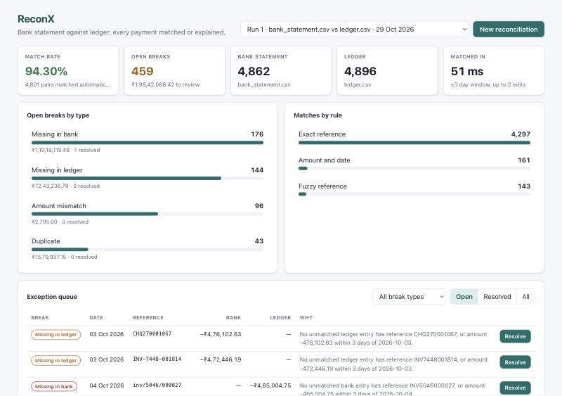

# ReconX

[](https://github.com/Rayudualapati-25/ReconX/actions/workflows/ci.yml)

A payment reconciliation engine. It matches a bank statement against an
internal ledger, flags every break (missing, duplicate or mismatched
payments) and shows the match rate on a dashboard.

Built with FastAPI, PostgreSQL and pandas, with a React + TypeScript
dashboard, test-first.

## Status

In progress. This README is the build plan; items are ticked as they land.

## MVP scope

- [x] CSV ingest for the bank statement and the ledger into PostgreSQL,
      normalising amounts (`Decimal`), dates and references
- [x] Pass 1: exact reference match with a hash map, O(n)
- [x] Pass 2: amount and date-window match with sorted two pointers,
      O(n log n)
- [x] Pass 3: fuzzy reference match (edit distance) on the leftovers only
      (it runs before pass 2: a similar reference is stronger evidence than a
      shared amount, see DECISIONS D10)
- [x] Break types with a reason for each: missing in bank, missing in ledger,
      amount mismatch, duplicate
- [x] REST API: upload both files, run a reconciliation, list and resolve
      breaks
- [x] React + TypeScript dashboard: match rate, breaks by type, exception
      queue with manual resolve
- [x] Benchmark against a naive O(n²) matcher on 100k rows, with the numbers
      in this README
- [ ] pytest suite with coverage (target 80%+), Docker Compose (API, Postgres,
      dashboard), GitHub Actions CI on every push
- [ ] `DECISIONS.md`: each design choice, the alternative considered, and what
      would change with hindsight

## Quick start

```bash
docker compose up --build
```

| Service | URL |
|---|---|
| Dashboard | <http://localhost:3000> |
| API and interactive docs | <http://localhost:8000/docs> |



On first start the API container migrates the database, uploads the two sample files in
[`samples/`](samples) through the same code as `POST /uploads`, and reconciles them, so the
dashboard opens on a finished run: the match rate, open breaks by type with the money in
doubt, matches by rule, and the exception queue. Pick a break type to filter the queue, and
**Resolve** a break with a note. **New reconciliation** uploads two other CSV files.

The sample files are synthetic (DECISIONS D29): fictional counterparties, invented references
and amounts, nothing real. `python3 scripts/smoke_test.py` checks a running stack end to end.

## Benchmark

The engine against a naive matcher that applies the same rules with nested loops, comparing
every bank entry with every ledger entry (DECISIONS D28). Both run on the same synthetic
statements, whose true pairs are known (D29), so the table also reports precision and recall.
Only matching is timed: no CSV parsing and no database (D31).

| Bank rows | Ledger rows | Engine | Engine rows/s | Naive O(n²) | Naive rows/s | Speed-up | Same matches | Precision | Recall | Match rate |
|---|---|---|---|---|---|---|---|---|---|---|
| 1,036 | 1,054 | 0.003 s | 734,579 | 0.04 s | 51,656 | 14x | yes | 100.00% | 99.90% | 94.26% |
| 10,254 | 10,283 | 0.041 s | 499,078 | 3.77 s | 5,448 | 92x | yes | 100.00% | 99.43% | 93.94% |
| 102,347 | 102,386 | 1.110 s | 184,458 | 389.24 s | 526 | 351x | yes | 100.00% | 99.33% | 93.77% |

Rows per second count both files. "Same matches" means the naive matcher found exactly the
pairs the engine found. Measured with `uv run python scripts/benchmark.py` on an Apple silicon
laptop (arm64, Python 3.12.16, one core). The naive run at 100,000 rows takes about six and a
half minutes; pass `--naive-max 10000` for a quick run.

End to end through the services behind the API, on a local PostgreSQL 16 container, the
100,000-row files took 3.89 s to parse and store, then 4.70 s to reconcile and store the 95,988
matches and every break, of which matching was 1.37 s. Pass `--database-url` (an empty,
migrated database) to reproduce it.

## Stack

Python 3.11+ · FastAPI · PostgreSQL 16 · SQLAlchemy 2 · pandas · React ·
TypeScript · pytest · Docker Compose · GitHub Actions

## Development

Requires Python 3.11+, [uv](https://docs.astral.sh/uv/) and PostgreSQL 16 for the tests.

```bash
uv sync                                   # virtualenv with runtime and dev dependencies
docker run -d --name reconx-test-db -p 5432:5432 \
  -e POSTGRES_USER=reconx -e POSTGRES_PASSWORD=reconx \
  -e POSTGRES_DB=reconx_test postgres:16-alpine
uv run pytest --cov                       # tests with branch coverage (80% floor)
uv run ruff check . && uv run ruff format --check . && uv run mypy
```

The dashboard needs Node 22:

```bash
cd dashboard && npm ci
npm run dev                               # http://localhost:5173, /api forwarded to :8000
npm test && npm run lint && npm run build
```

The tests use `TEST_DATABASE_URL` (see `.env.example`) and default to the container above.
Design choices and their trade-offs are recorded in [DECISIONS.md](DECISIONS.md).

## Done when

- `docker compose up` starts the API, the database and the dashboard
- CI is green on every push
- This README reports measured numbers: rows matched per second against the
  O(n²) baseline, match rate on the seeded data, tests and coverage
